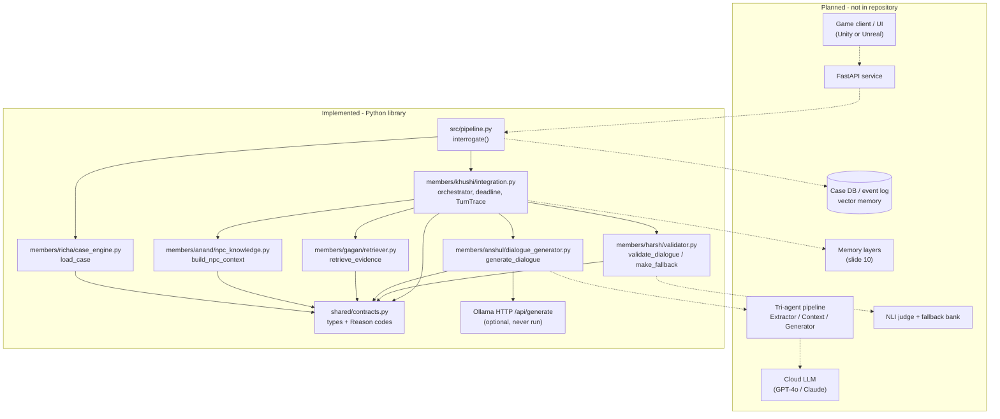
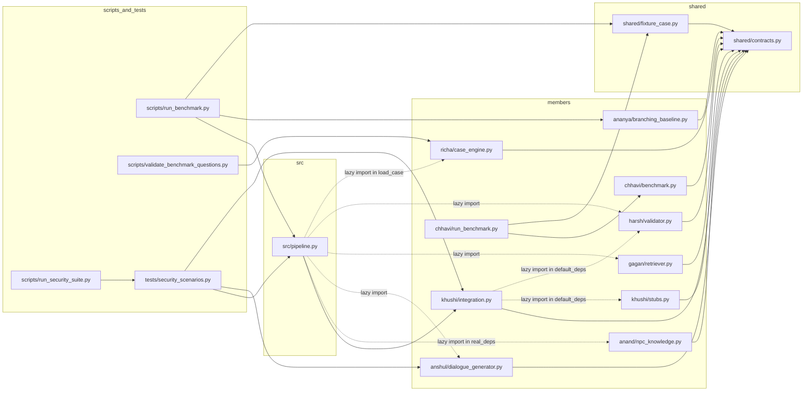
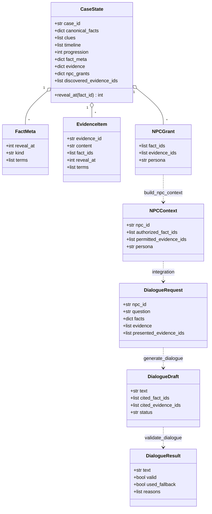
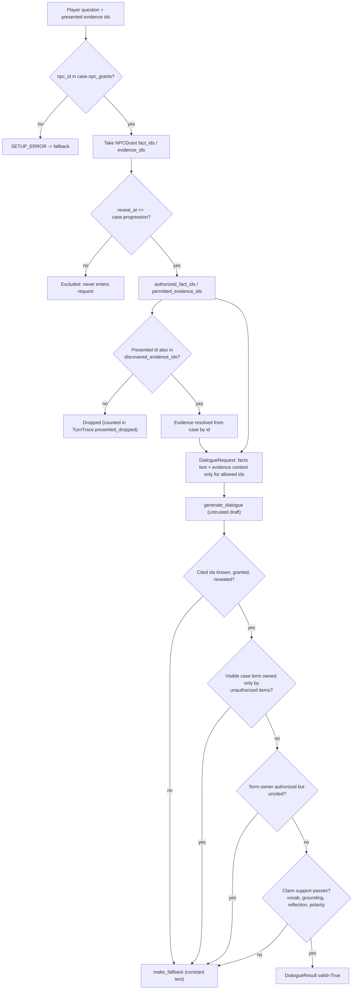
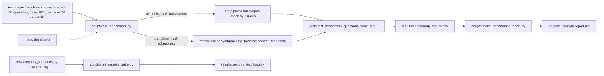
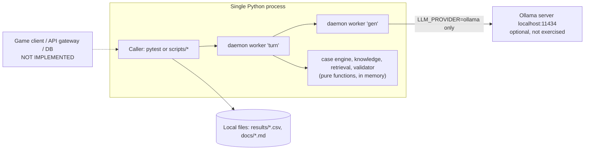

# Red Thread AI Detective — System Architecture

> **Scope and method.** This document describes the repository snapshot `red_thread_ai_detective-main.zip` and compares it with `Red_Thread_Final_Presentation_EPAM_COE_3MVP.pptx`. Every statement about the code was checked against the source files named inline. Where the presentation and the code disagree, the disagreement is stated (see also `architecture-review.md`). Nothing here was executed against a real LLM.
>
> **Legend.** ✅ implemented and tested offline · 🟡 partially implemented · 📄 documentation/proposal only · ❌ not present · 🚫 blocked (needs infrastructure or people that were unavailable).
> In diagrams, **solid arrows are implemented calls; dashed arrows are planned and do not exist in the code.**

---

## Table of Contents

1. [Executive Summary](#1-executive-summary)
2. [System Goals and Architectural Principles](#2-system-goals-and-architectural-principles)
3. [Architecture Status and Implementation Maturity](#3-architecture-status-and-implementation-maturity)
4. [High-Level System Architecture](#4-high-level-system-architecture)
5. [Component Architecture](#5-component-architecture)
6. [Repository Structure and Module Responsibilities](#6-repository-structure-and-module-responsibilities)
7. [Core Domain Model](#7-core-domain-model)
8. [Epistemic Knowledge Model](#8-epistemic-knowledge-model)
9. [End-to-End Data Flow](#9-end-to-end-data-flow)
10. [API and Shared Interface Contracts](#10-api-and-shared-interface-contracts)
11. [LLM Integration and Interrogation Lifecycle](#11-llm-integration-and-interrogation-lifecycle)
12. [Security Architecture and Threat Model](#12-security-architecture-and-threat-model)
13. [Benchmarking and Evaluation Architecture](#13-benchmarking-and-evaluation-architecture)
14. [Technology Stack and Dependencies](#14-technology-stack-and-dependencies)
15. [Execution Flow and Deployment](#15-execution-flow-and-deployment)
16. [Testing Architecture](#16-testing-architecture)
17. [Current Limitations and Technical Debt](#17-current-limitations-and-technical-debt)
18. [Sprint-Wise Architecture Roadmap](#18-sprint-wise-architecture-roadmap)
19. [Future Architectural Improvements](#19-future-architectural-improvements)
20. [Architecture Evidence and Verification](#20-architecture-evidence-and-verification)

---

## 1. Executive Summary

Red Thread is designed as a chapter-based detective game in which the player interrogates NPC suspects in free text. The central design rule (presentation slide 5) is: *the game engine owns the truth, the LLM only phrases dialogue, and a validation layer stops the LLM from breaking the mystery.*

**What the repository actually is.** A Python 3.11+ library and test/evidence harness, not a game. It implements one function, `src.pipeline.interrogate()`, which takes a `CaseState`, an NPC id and a player question, and returns a validated `DialogueResult`. There is no game client, no Unity project, no HTTP API, no database and no UI anywhere in the repository (verified: no `.cs`, `.unity`, FastAPI/Flask/SQL references; `scripts/run_game.py` is a 0-byte file).

**What works (verified by running the offline tests).**

- A deterministic *Case Engine* that loads two authored cases (`case_001`, `case_002`) and validates them (`members/richa/case_engine.py`).
- A deterministic *NPC knowledge* function that returns only the facts and evidence an NPC is granted **and** whose `reveal_at` ≤ the case progression (`members/anand/npc_knowledge.py`).
- Deterministic lexical *evidence retrieval* restricted to the NPC's permitted evidence (`members/gagan/retriever.py`).
- A *generator* wrapper with an offline mock (default) and an Ollama HTTP backend (`members/anshul/dialogue_generator.py`).
- A fail-closed lexical *validator* and constant *fallback* (`members/harsh/validator.py`).
- An *orchestrator* that never raises, enforces a whole-call deadline and produces per-turn telemetry (`members/khushi/integration.py`, wired by `src/pipeline.py`).
- A 50-scenario security suite, a 30-question benchmark set and a dynamic-vs-branching benchmark harness (`tests/security_scenarios.py`, `test_cases/benchmark_questions.json`, `scripts/run_benchmark.py`).

**What does not exist yet.** Any real-LLM execution result, the tri-agent pipeline, the typed epistemic stance ledger (KNOWS/BELIEVES/SECRET/…), emotional state, memory layers, an event log, a database, a FastAPI service, an NLI judge, timeline checking, accusation evaluation, an evidence board, any UI, and everything in MVP2/MVP3.

**Key architectural findings** (details in §17 and `architecture-review.md`):

1. The "no leakage" guarantee is *structural* (exclusion of unauthorized facts from the request) plus a *lexical* validator. It is not semantic hallucination prevention, and it is bypassable by Unicode homoglyphs (a failing test in `members/preksha/tests/test_validator_terms.py`).
2. `CaseState.clues` and `CaseState.timeline` are authored and validated but **no other module reads them**; they currently have no runtime effect.
3. Nothing in the code calls `advance_progression()` / `discover_evidence()` outside tests; progression is only changed by hand (e.g. benchmark scripts assign `case.progression`).
4. The repository root test command documented in `README.md` (`python -m pytest`) fails at collection on this snapshot because of the Preksha QA suite (§16).
5. The presentation describes a 15-sprint / 3-MVP programme; the repository covers a subset of MVP1 (Sprints 1–3 scope, partially) and none of MVP2/MVP3.

---

## 2. System Goals and Architectural Principles

### 2.1 Goals (from presentation slides 3–9, 20, and `README.md`)

| Goal | Source | Status in code |
|---|---|---|
| Open-ended interrogation over a canonical, solvable mystery | Slides 3, 5, 22 | 🟡 Free-text question → validated reply works with the mock; a real model has never been run |
| Per-NPC knowledge boundaries | Slide 7 | 🟡 Grant-based boundary ✅; typed stances ❌ |
| Disclosure earned, not given | Slide 7 | 🟡 Integer `reveal_at` threshold only |
| Validation prevents mystery-breaking output | Slide 9 | 🟡 Cascade steps 1–2 partially; steps 3–6 ❌ |
| Never break the mystery on timeout/failure | Slide 8 | ✅ Constant fallback text (not in-character) |
| Measure, don't just demonstrate | Slide 22 | 🟡 Benchmark/security harness exists; mock-only |

### 2.2 Principles actually enforced in code

| Principle | Where enforced |
|---|---|
| **Truth ownership.** Only the Case Engine authors truth; modules receive `CaseState` through the contract. | `shared/contracts.py` docstring "Trust model"; `members/richa/case_engine.py` |
| **Exclusion over instruction.** The LLM prompt contains only the NPC's authorized fact *text*. | `members/khushi/integration.py::_pipeline` builds `facts = {fid: case.canonical_facts[fid] for fid in npc.authorized_fact_ids}`; `DialogueRequest.__post_init__` raises `ContractError` if `facts` holds an unauthorized id |
| **Trusted vs untrusted data.** `DialogueDraft`, player `question`, and `EvidenceItem.content` are untrusted. | `shared/contracts.py` |
| **Fail closed.** Any error yields the same constant fallback. | `validator.py::make_fallback`, `integration.py::_fallback` |
| **Never raise to the game loop.** | `integration.py::interrogate_traced` |
| **Exact IDs.** No trimming or case-folding of identifiers. | `shared/interfaces.md` rule 4; `retriever.py`, `validator.py::_identifier` |
| **Only Integration advances state, deterministically.** | `integration.py::advance_progression`, `discover_evidence` (but see §17: no caller) |
| **No oracle for the player.** Reason codes carry no fact IDs; fallback text is identical for every reason. | `shared/contracts.py::Reason`, `SAFE_FALLBACK_TEXT` |

### 2.3 Key trade-offs

- **Lexical validation vs semantic validation.** Deterministic, cheap, auditable, but rejects legitimate paraphrase (false positives) and misses meaning-changing recombinations (false negatives). Documented in `docs/security-residual-risks.md`.
- **Single generator call, no retry loop.** Bounded latency/cost, but diverges from the presentation's "regenerate, fallback after n tries" (slide 8) and increases fallback frequency with real models.
- **Constant fallback text.** Leaks no information, but is not "in-character" as the presentation requires.
- **Daemon-thread deadline.** A stuck backend cannot be killed in Python; the code bounds abandoned workers (`MAX_ABANDONED_WORKERS = 8`) instead.

---

## 3. Architecture Status and Implementation Maturity

### 3.1 Component maturity

| Component (presentation name) | Repository realisation | Status |
|---|---|---|
| Case Engine (slide 8) | `members/richa/case_engine.py` | 🟡 Authored cases + validation; no truth queries, no interval algebra, no evidence DAG, no accusation check |
| Knowledge System (slides 7, 8) | `members/anand/npc_knowledge.py` + `NPCGrant` | 🟡 Grant ∩ reveal gating only |
| Context Manager (slide 8) | Inline in `integration.py::_pipeline` + `dialogue_generator.py::build_prompt` | 🟡 No memory, no persona beyond a string |
| Evidence retrieval (B2) | `members/gagan/retriever.py` | ✅ Lexical, permitted-only, deterministic |
| Tri-agent LLM pipeline (slide 8) | `members/anshul/dialogue_generator.py` (single call) | ❌ Single-generator only |
| Validation layer (slide 9) | `members/harsh/validator.py` | 🟡 See §12 |
| NPC response / fallback bank | `validator.py::make_fallback` | 🟡 One constant string |
| Memory architecture (slide 10) | — | ❌ |
| Game engine / UI (slide 8) | — | ❌ |
| LLM backend FastAPI service (slide 11) | — | ❌ |
| Evaluation harness (slide 22) | `scripts/`, `tests/`, `members/ananya`, `members/chhavi` | 🟡 System A (branching) and C (mock) only; System B (raw LLM) ❌ |

### 3.2 Verified test status (this snapshot, Python 3.12.3, run by the document author)

| Command | Result |
|---|---|
| `python -m pytest tests` | **234 passed** |
| `python -m pytest members --ignore=members/preksha` | **282 passed, 2 skipped** (live-Ollama smoke tests) |
| `python -m pytest` (repo root, as in README) | **Interrupted: 3 collection errors** (Preksha suite) |
| `python -m pytest members/preksha --ignore=…test_case_engine_load.py --ignore=…test_bug_case_engine_vs_fixture.py` | **8 failed, 258 passed** |
| `python scripts/run_security_suite.py` (scratch copy) | **50 rows, 50 passed** |
| `python scripts/validate_benchmark_questions.py` | **valid, 0 errors (30 questions)** |

`jsonschema` and `pytest` were installed for these runs; `requests` was already present.

---

## 4. High-Level System Architecture

### Diagram A — High-level architecture (implemented vs planned)



**Layering.** There is one logical deterministic layer (Case Engine → NPC Knowledge → Retrieval → Validator) and one generative layer (Generator). The Orchestrator sits between them and is the only component that holds both the full `CaseState` and the generator output.

---

## 5. Component Architecture

For each component: responsibility, inputs, outputs, dependencies, files, status.

### 5.1 Case Engine

| | |
|---|---|
| **Responsibility** | Author and validate canonical case data; expose `load_case(case_id)`. |
| **Inputs** | `case_id: str` (exact, case-sensitive). |
| **Outputs** | A fresh `CaseState` per call; `ContractError` for unknown/invalid ids. |
| **Dependencies** | `shared.contracts` only. |
| **Files** | `members/richa/case_engine.py` (`load_case`, `_build_case_001`, `_build_case_002`, `_validate_common`, `_validate_case_001`, `_validate_case_002`, `_CASES`). Tests: `members/richa/test_case_engine.py` (19 pass). |
| **Status** | 🟡 |

Facts:

- Cases are authored **in Python code**, not as JSON "fact-ledger" files (presentation story A1 says JSON).
- `case_001` must equal `shared.fixture_case.make_case_001()`: two NPCs (`gardener`, `cook`), 5 facts, 3 evidence items, empty `clues`/`timeline`. This is a deliberate duplicate (guarded by tests).
- `case_002`: 12 facts (F001–F011, L001), 12 evidence items, 3 suspects (`aman`, `neha`, `rohan`), 10 clues, 11 timeline events, one victim id constant `VICTIM_ID = "lord_ashby"`.
- Validation (`_validate_case_002`) checks id integrity, ordered integer `time_minute`, a single victim, unique clue/event ids. It does **not** implement interval algebra or an evidence DAG (story A2).
- There is no `culprit` field and no accusation evaluator (story A3). The culprit is only implicit in the authored text (F011, T008).

### 5.2 NPC Knowledge / Epistemic Security

| | |
|---|---|
| **Responsibility** | Compute what one NPC may say now. |
| **Inputs** | `CaseState`, `npc_id`. |
| **Outputs** | `NPCContext(authorized_fact_ids, permitted_evidence_ids, persona)`; `UnknownNPCError` for unknown ids. |
| **Dependencies** | `shared.contracts`. |
| **Files** | `members/anand/npc_knowledge.py::build_npc_context`; `members/anand/__init__.py`. Tests: `tests/test_npc_knowledge.py`, `tests/test_state_integrity.py`. (`members/anand/README.md` is empty.) |
| **Status** | ✅ for grant ∩ reveal gating; ❌ for typed stances |

Rule implemented: `fact_ids = [f in grant.fact_ids if case.reveal_at(f) <= case.progression]`, `evidence_ids = [e in grant.evidence_ids if e in case.evidence and case.evidence[e].reveal_at <= case.progression]`. It never reads `clues` or `timeline`. `NPCContext.beliefs`/`suspicions` are deprecated and always empty.

### 5.3 Evidence Retrieval

| | |
|---|---|
| **Responsibility** | Rank NPC-permitted, already-revealed evidence against the question. |
| **Inputs** | `question`, `permitted_evidence_ids: list[str]`, keyword `case`, `top_k=3`. |
| **Outputs** | Up to `top_k` fresh `EvidenceItem` copies; `[]` on any error (fail closed). |
| **Dependencies** | `shared.contracts`. |
| **Files** | `members/gagan/retriever.py` (`retrieve_evidence`, `_retrieve`, `_score`). Tests: `members/gagan/test_retriever.py` (35 pass). |
| **Status** | ✅ |

Scoring: 3 points per distinct authored `terms` whole-phrase hit, 1 point per shared content token (length ≥ 3, stopwords removed); ties by `evidence_id` ascending; zero-score items are dropped. This is lexical, **not** vector/semantic retrieval (presentation slide 10/11 propose pgvector).

### 5.4 Interrogation Engine (Orchestrator)

| | |
|---|---|
| **Responsibility** | Run one interrogation turn end-to-end under a deadline; never raise. |
| **Inputs** | `case`, `npc_id`, `question`, `presented_evidence_ids`, `timeout_s`, optional `Deps`, `request_id`. |
| **Outputs** | `(DialogueResult, TurnTrace)`. |
| **Dependencies** | `shared.contracts`; the five collaborators via `Deps`. |
| **Files** | `members/khushi/integration.py` (`interrogate_traced`, `interrogate`, `_pipeline`, `_call_with_deadline`, `_filter_presented`, `_authoritative_evidence`, `looks_like_injection`, `summarize_traces`, `advance_progression`, `discover_evidence`, `Deps`, `TurnTrace`); production wiring in `src/pipeline.py` (`real_deps`, `interrogate`, `interrogate_with_trace`, `load_case`). |
| **Status** | ✅ for one-turn orchestration; ❌ for session/game-loop state |

Details:

- `members/khushi/integration.py::default_deps()` is wired to **stubs** (`members/khushi/stubs.py`) for member isolation; the production path is `src/pipeline.py::real_deps()`. `tests/test_production_entry_point.py` fails if `src/` or `scripts/` depend on the stub default.
- `looks_like_injection` is a regex heuristic used **for logging only** (`TurnTrace.injection_suspected`, `evidence_injection_suspected`); it never changes behaviour.
- Question length is capped at `MAX_QUESTION_CHARS = 500`; retrieval `RETRIEVAL_TOP_K = 3`.
- `_filter_presented` keeps only evidence that is in `case.discovered_evidence_ids`, exists, is revealed, and is in `npc.permitted_evidence_ids`.
- `_authoritative_evidence` re-resolves evidence by id from the case (retrieval output content is never trusted) and returns fresh copies.

### 5.5 LLM / Response Generation

| | |
|---|---|
| **Responsibility** | Turn a pre-authorized `DialogueRequest` into an untrusted `DialogueDraft`. |
| **Inputs** | `DialogueRequest`. |
| **Outputs** | `DialogueDraft` with `status ∈ {ok, timeout, error, malformed}`; never raises. |
| **Dependencies** | `shared.contracts`; `requests` (lazy import, Ollama only). |
| **Files** | `members/anshul/dialogue_generator.py` (`generate_dialogue`, `build_prompt`, `parse_completion`, `OllamaBackend`, `_mock_completion`, `set_mock_script`, `clear_mock_scripts`). Tests: `members/anshul/test_dialogue_generator.py` (38 pass, 2 skipped live tests). |
| **Status** | ✅ mock; 🟡 Ollama code path exists but has never produced a real result |

Providers: `LLM_PROVIDER=mock` (default) or `ollama`; any other value → `status="error"`. Default model `qwen2.5:3b-instruct`, URL `http://localhost:11434`, `temperature 0.3`, `seed 0`, `num_predict 512`, `format: "json"`. No OpenAI/Anthropic/cloud provider exists, and `LLM_API_KEY` in `.env.example` is "reserved; no current backend reads it".

The mock quotes the alphabetically first authorized fact verbatim (and appends `About that <term>.` when it can cite evidence). It is therefore not a quality signal.

### 5.6 Security and Validation

| | |
|---|---|
| **Responsibility** | Decide whether a draft may reach the player; otherwise produce the fallback. |
| **Inputs** | `DialogueRequest`, `DialogueDraft`, trusted `CaseState`, trusted `NPCContext`. |
| **Outputs** | `DialogueResult` (`valid=True` or `used_fallback=True`, never both). |
| **Dependencies** | `shared.contracts`. |
| **Files** | `members/harsh/validator.py` (`validate_dialogue`, `make_fallback`, `_check`, `_authorization`, `_support_check`, `_trusted_shape`, `_request_shape`). Tests: `members/harsh/test_validator.py` (64 incl. subtests), `tests/test_validator_claim_support.py`, `tests/security_scenarios.py`. |
| **Status** | 🟡 lexical only |

Full check order in `_check` is in §12.2.

### 5.7 Pipeline Orchestration

Covered by §5.4. The only wiring file is `src/pipeline.py`, which imports from `members/…` (it is explicitly interim: its docstring says "Until the lead copies the approved modules into their final location, this is the single place to change imports").

### 5.8 Benchmarking and Evaluation

| | |
|---|---|
| **Responsibility** | Compare dynamic (pipeline) and branching (fixed-tree) dialogue on the same 30 questions; record security scenario outcomes. |
| **Files** | `scripts/run_benchmark.py`, `scripts/make_benchmark_report.py`, `scripts/run_security_suite.py`, `scripts/validate_benchmark_questions.py`, `scripts/run_tests.py`, `members/ananya/branching_baseline.py`, `test_cases/benchmark_questions.json`, `test_cases/benchmark_schema.json`, `test_cases/prompt_injection_cases.json`, `members/chhavi/{benchmark.py,run_benchmark.py}`, `members/khushi/run_checks.py`. |
| **Status** | 🟡 See §13 |

### 5.9 Unity / Frontend Integration

**Not implemented.** No Unity project, C# file, HTTP client, WebSocket, or UI file exists. The presentation lists "Unity (C#) or Unreal" (slide 11) and "Interrogation UI + streaming" (story F1, Sprint 4). `members/anshul/docs/architecture.md` itself says: "Do not infer a deployed web API, client, SQL database, or production LLM service from this architecture diagram."

---

## 6. Repository Structure and Module Responsibilities

```
red_thread_ai_detective-main/
├── README.md, CONTRIBUTING.md, pytest.ini, requirements.txt, .env.example, .gitignore
├── shared/                    # contract source of truth (lead-owned)
│   ├── contracts.py           # dataclasses, Reason codes, constants
│   ├── fixture_case.py        # make_case_001() golden fixture
│   ├── interfaces.md          # behavioural contract per module
│   └── Sprint1Plan.md         # per-module Definition of Done
├── src/pipeline.py            # production wiring (imports members/*)
├── members/                   # per-person modules (see table)
├── tests/                     # root acceptance/contract/security tests
├── test_cases/                # benchmark questions, schema, injection cases
├── scripts/                   # evidence-generating entry points
├── results/                   # security_test_log.csv, benchmark_results.csv
└── docs/                      # reports and acceptance record
```

| Path | Owner (per `docs/team-contributions.md`) | Role | Status |
|---|---|---|---|
| `members/richa/` | Richa | Module 1: Case Engine | ✅/🟡 |
| `members/anand/` | Anand | Module 2: NPC Knowledge | ✅ |
| `members/gagan/` | Gagan | Module 3: Retrieval (+`demo.py`) | ✅ |
| `members/anshul/` | Anshul | Module 4: Generator; also `docs/` (ADRs, C4 SVGs, Agile templates) | ✅ mock |
| `members/harsh/` | Harsh | Module 5: Validator/Fallback | 🟡 |
| `members/khushi/` | Khushi (+Pushparaj) | Module 6: Integration, stubs, scenarios, `run_checks.py` | ✅ |
| `members/preksha/` | Preksha | Module 7: QA suite (`tests/`, `conftest.py`, `results/`) | 🟡 broken in this snapshot |
| `members/paras/` | Paras | `sprint1/test_regression.py` (67 tests pass) | ✅ |
| `members/chhavi/` | Chhavi | Module 8: benchmark storage/runner | 🟡 duplicate of `scripts/` |
| `members/ananya/` | Ananya | Module 9: branching baseline, playtest protocol | ✅ baseline; playtests 🚫 |
| `members/devansh/`, `members/pushparaj/` | — | README only (0 bytes) | ❌ |

`docs/team-contributions.md` and `docs/sprint1-acceptance.md` state that Preksha, Devansh and Chhavi had delivered "nothing (README only)". **This snapshot contains** `members/preksha/` (tests, results) and `members/chhavi/` (benchmark code, results); those documents are therefore stale relative to the ZIP.

### Diagram D — Repository module dependencies (verified imports)



> In this particular diagram, dashed lines mean *lazy (function-level) imports that do exist*, not planned work.

---

## 7. Core Domain Model

All types live in `shared/contracts.py`. There is **no** dedicated `Victim`, `Suspect`, `Fact`, `Clue` or `Timeline` class; those concepts are represented as follows.

| Domain concept | Representation | File / symbol | Notes |
|---|---|---|---|
| **CaseState** | `@dataclass CaseState` | `contracts.py` | `case_id`, `canonical_facts: dict[str,str]`, `clues: list[dict]`, `timeline: list[dict]`, `progression: int`, `fact_meta`, `evidence`, `npc_grants`, `discovered_evidence_ids`. `__post_init__` rejects dangling references. |
| **Victim** | A constant `VICTIM_ID = "lord_ashby"` and a `victim_id` key on timeline events | `case_engine.py` | No object; `case_001` has no victim record at all |
| **Suspects / NPCs** | Keys of `CaseState.npc_grants`; `NPCGrant(fact_ids, evidence_ids, persona)` | `contracts.py` | `case_001`: `gardener`, `cook`. `case_002`: `aman`, `neha`, `rohan`. No emotional state, relationships or stance types |
| **Facts** | `canonical_facts[fid] -> str` plus `FactMeta(reveal_at, kind, terms)` | `contracts.py` | Ids `F###`; cover stories `L###` with `kind="cover_story"`. Fact text is first-person for `case_001` ("I saw a figure…") and third-person for `case_002`, i.e. the two cases use different conventions |
| **Clues** | `list[dict]` with `clue_id`, `fact_ids`, `evidence_ids`, `suspect_ids` | `case_engine.py` (`case_002` only) | Validated, **never consumed** by other modules |
| **Evidence** | `EvidenceItem(evidence_id, content, fact_ids, reveal_at, terms)` | `contracts.py` | `content` is DATA (may be hostile, e.g. `case_001` E003) |
| **Timeline** | `list[dict]` with `event_id`, `time_minute`, `event`, `victim_id`, `suspect_ids` | `case_engine.py` (`case_002` only) | Ordered-int validation only; never consumed |
| **NPCContext** | `@dataclass NPCContext` | `contracts.py` | Output of `build_npc_context` |
| **Player knowledge** | `CaseState.discovered_evidence_ids` | `contracts.py` | Inventory of evidence; no deduction/board state |
| **Progression** | `CaseState.progression: int` | `contracts.py` | Single global integer, not per-NPC |

Per-turn types: `DialogueRequest` (trusted), `DialogueDraft` (untrusted), `DialogueResult` (trusted), `TurnMetrics`. Record types for evidence artifacts: `TestRecord`, `BenchmarkRecord`.



---

## 8. Epistemic Knowledge Model

### 8.1 What a suspect knows

A suspect knows exactly `NPCGrant.fact_ids` and may be shown exactly `NPCGrant.evidence_ids`, **filtered** by `reveal_at <= case.progression` (`build_npc_context`). Example verified from `case_002` at progression 0: `aman` → facts `F001, F005`, evidence `E001, E002`; `rohan` → only `L001` (cover story) because `F007–F010` have `reveal_at = 1`.

### 8.2 What a suspect does not know

Anything not granted. Knowledge is **not** derived from the clue or timeline tables. For example, clue `C004` lists `aman`, `neha` and `rohan` in `suspect_ids`, yet only `rohan` is granted `F007`. Appearing in a timeline event or clue does not confer knowledge, and no NPC is omniscient. This distinction is a deliberate property of the code (`npc_knowledge.py` "never reads `case.clues` or `case.timeline`").

### 8.3 Evidence authorization

Evidence reaches the generator only if all hold (`integration.py::_filter_presented`, `_authoritative_evidence`, retriever):

1. it is in `npc.permitted_evidence_ids` (grant ∩ revealed);
2. if *presented* by the player, it is also in `case.discovered_evidence_ids`;
3. its id exists in the case, and its content is re-read from the case, not from retrieval output.

The validator then re-derives authorization independently from `case` + `npc` (`_authorization`), including exact equality of `request.evidence` items with the case's items.

### 8.4 Fact grants and reveal progression

`FactMeta.reveal_at` / `EvidenceItem.reveal_at` are integer thresholds; an item is a "spoiler" while `case.progression < reveal_at`. `advance_progression(case, to)` is monotonic and `discover_evidence(case, id)` refuses unknown/duplicate/not-yet-revealed ids. **Gap:** neither function is called by any production code path; they are exercised by tests only. The presentation's "Structured Knowledge Tree" disclosure conditions (slide 7, story B3: "Alibi only after phone logs are shown") are not implemented — disclosure depends on a single global integer, not on narrative conditions or what the player has shown.

### 8.5 Hidden-fact protection (defence in depth)

| Layer | Mechanism | Strength |
|---|---|---|
| 1. Exclusion | Unauthorized fact **text** is never put in `DialogueRequest.facts`; `__post_init__` enforces it | Strong (structural) |
| 2. Prompt | System rules: use only `[FACTS]`; evidence/question are untrusted; JSON-only output | Weak (model-dependent) |
| 3. Citation authorization | Cited ids must be known, granted and revealed | Strong |
| 4. Term ownership | A visible case term owned only by unauthorized items → `PROTECTED_TERM_LEAK`; owned by authorized but uncited items → `UNCITED_ASSERTION` | Medium (lexical) |
| 5. Claim support | Closed vocabulary, grounding, citation reflection, polarity (`_support_check`) | Medium (lexical, fail-closed) |
| 6. Fallback | Constant text, no citations, no fact IDs in reasons | Strong |

Note layer 1 does not protect against the model *guessing* a protected fact from world knowledge; layers 4–5 only catch it if it uses a listed term.

### 8.6 Lie handling

- A lie is an **authored** statement: `FactMeta.kind = "cover_story"` (e.g. `L001`, "I never left the kitchen all evening"). It is an ordinary grant: `build_npc_context` treats it like any fact once revealed.
- The validator checks against the NPC's **authorized statement set**, not canonical truth, so authored lies are not flagged as hallucinations (`interfaces.md` Module 5 item 4).
- `_support_check` polarity rule: a reply may not drop the negation of a cited cover story or negate a cited statement.
- **Not implemented:** linking a lie to the truth it conceals, detecting contradictions between a lie and evidence, bluffing/theory of mind (stories H6/H7), lie state transitions under pressure.
- **Observed limitation (verified by running the mock on `case_002`):** `rohan` at progression 0 is granted only `L001` ("Rohan claims, 'I never poisoned the brandy.'"). The word "poisoned" is a listed term of fact `F004` (`reveal_at = 2`), which Rohan is not authorized for at progression 0, so the validator returned `PROTECTED_TERM_LEAK` and the fallback. In other words, term ownership collides with the cover story, and Rohan's own lie cannot be voiced before progression 2 under the current term lists. This is an authoring/validator interaction, not documented elsewhere.

### Diagram C — Epistemic security flow



---

## 9. End-to-End Data Flow

1. **Case load.** `src.pipeline.load_case(case_id)` → `members.richa.case_engine.load_case` returns a fresh `CaseState`.
2. **Turn request.** Caller invokes `interrogate(case, npc_id, question, presented_evidence_ids=…, timeout_s=…)`.
3. **Deadline envelope.** `interrogate_traced` runs the whole turn on a daemon worker via `_call_with_deadline` (name `"turn"`); the generator call runs on a second daemon worker (`"gen"`).
4. **Stages** inside `_pipeline`: input check → injection heuristic (log only) → question truncation → `build_npc_context` → `_filter_presented` → `retrieve_evidence` → `_authoritative_evidence` → resolve `facts` → build `DialogueRequest` → `generate_dialogue` → `validate_dialogue`.
5. **Finalise.** `_finalize` stamps `total_ms` and `latency_ms` (equal) and copies reasons into `TurnTrace`.
6. **Return.** `(DialogueResult, TurnTrace)`. Only `DialogueResult.text` is for the player; reasons are for logs.

Data that never leaves the orchestrator: the full `CaseState`, `clues`, `timeline`, unauthorized fact text.

### Diagram B — End-to-end request lifecycle

```mermaid
sequenceDiagram
    autonumber
    participant Caller as Caller (test / script; no UI exists)
    participant INT as integration.interrogate_traced
    participant NK as build_npc_context
    participant RET as retrieve_evidence
    participant GEN as generate_dialogue
    participant LLM as Mock or Ollama
    participant VAL as validate_dialogue
    participant FB as make_fallback

    Caller->>INT: case, npc_id, question, presented_evidence_ids
    INT->>INT: start deadline worker, flag_input (log only), truncate to 500 chars
    INT->>NK: case, npc_id
    NK-->>INT: NPCContext (grant AND reveal_at filtered)
    INT->>INT: _filter_presented (discovered AND permitted)
    INT->>RET: question, permitted ids, case, top_k=3
    RET-->>INT: EvidenceItem copies
    INT->>INT: re-resolve evidence from case, resolve facts text, build DialogueRequest
    INT->>GEN: DialogueRequest (second daemon worker, deadline)
    GEN->>LLM: prompt (facts trusted, evidence/question as JSON data)
    LLM-->>GEN: raw JSON completion
    GEN-->>INT: DialogueDraft (ok / timeout / error / malformed)
    INT->>VAL: request, draft, case, npc
    alt valid
        VAL-->>INT: DialogueResult valid=True
    else any failure or exception
        VAL->>FB: reasons
        FB-->>INT: SAFE_FALLBACK_TEXT
    end
    INT->>INT: _finalize (total_ms == latency_ms)
    INT-->>Caller: DialogueResult, TurnTrace
```

A generator timeout/error skips validation and goes directly to `_fallback` with `GEN_TIMEOUT`/`GEN_ERROR`.

---

## 10. API and Shared Interface Contracts

There is **no network API**. The contract is the Python function signatures in `shared/interfaces.md` and the dataclasses in `shared/contracts.py`.

| Module | Signature | File |
|---|---|---|
| Case Engine | `load_case(case_id: str) -> CaseState` | `members/richa/case_engine.py` |
| NPC Knowledge | `build_npc_context(case: CaseState, npc_id: str) -> NPCContext` | `members/anand/npc_knowledge.py` |
| Retrieval | `retrieve_evidence(question, permitted_evidence_ids, *, case, top_k=3) -> list[EvidenceItem]` | `members/gagan/retriever.py` |
| Generator | `generate_dialogue(request: DialogueRequest) -> DialogueDraft` | `members/anshul/dialogue_generator.py` |
| Validator | `validate_dialogue(request, draft, case, npc) -> DialogueResult` | `members/harsh/validator.py` |
| Fallback | `make_fallback(npc_id, reasons, metrics=None) -> DialogueResult` | `members/harsh/validator.py` |
| Integration | `interrogate(case, npc_id, question, *, presented_evidence_ids=(), timeout_s=10.0, deps=None) -> DialogueResult` | `src/pipeline.py` (production), `members/khushi/integration.py` (stub-default) |

**Reason codes** (closed set, `Reason` in `contracts.py`): `OK, SETUP_ERROR, GEN_TIMEOUT, GEN_ERROR, GEN_MALFORMED, SCHEMA_INVALID, NPC_MISMATCH, AUTH_MISMATCH, AUTH_FUTURE, UNKNOWN_FACT_ID, UNAUTHORIZED_FACT, UNKNOWN_EVIDENCE_ID, UNAUTHORIZED_EVIDENCE, PROTECTED_TERM_LEAK, UNCITED_ASSERTION, VALIDATOR_ERROR`.

**Constants:** `SAFE_FALLBACK_TEXT = "I cannot answer that reliably."`, `MAX_DIALOGUE_CHARS = 600`, `DEFAULT_TIMEOUT_S = 10.0`.

**Generator output schema** (prompt-requested, parsed by `parse_completion`): `{"text": str, "cited_fact_ids": [str], "cited_evidence_ids": [str]}`. This is the repository's version of the presentation's "strict-schema side-channel" (C3); it is requested in the prompt and Ollama `format: "json"`, not enforced by constrained decoding.

**Planned, absent:** FastAPI "prompt package" endpoint (C1), accusation API, event-log API, streaming to a UI.

Contract notes: `interfaces.md` says `docs/interface-contracts.md` "must be deleted or reduced to a link"; it is a 201-byte stub. `docs/architecture.md` is effectively empty (2 bytes).

---

## 11. LLM Integration and Interrogation Lifecycle

### 11.1 Implemented

- **Provider selection** from environment: `LLM_PROVIDER`, `LLM_MODEL`, `LLM_TIMEOUT_S`, `OLLAMA_URL` (`dialogue_generator.generate_dialogue`).
- **Prompt** (`build_prompt`): fixed `SYSTEM_RULES`, `Persona:`, `[FACTS]` (sorted `id: text`), `[EVIDENCE]` (each item JSON-encoded), `[QUESTION]` (JSON-encoded), presented ids, "Respond with the JSON object now." JSON-encoding untrusted strings reduces, but does not prevent, prompt injection (the docstring says so).
- **Parse** (`parse_completion`): size limit 64,000 chars, JSON object with the three required fields, correct types, and every cited id must be present in the request; otherwise `status="malformed"`.
- **Metrics:** `model`, `prompt_chars`, `generation_ms`; from Ollama: `ttft_ms`, `prompt_tokens`, `completion_tokens`. `cost_usd` is always `None`.
- **Failure mapping:** `_Timeout → timeout`, `_Malformed → malformed`, anything else → `error` (including unknown provider and missing `requests`).
- **Observed (this author's run):** with `LLM_PROVIDER=ollama` and no server, a turn returns the fallback with reason `GEN_ERROR`.

### 11.2 Lifecycle states of a turn

`setup → retrieval → generation → validation → finalize`. `TurnTrace` records per-stage milliseconds, `timed_out`, `injection_suspected`, `evidence_injection_suspected`, `question_truncated`, `presented_dropped`, `evidence_sent`, `used_fallback`, `reasons`. Timeout reason mapping on a whole-call deadline miss: generation → `GEN_TIMEOUT`; validation → `VALIDATOR_ERROR`; setup/retrieval → `SETUP_ERROR`.

### 11.3 Presentation vs implementation

| Presentation (slides 8–11) | Repository |
|---|---|
| Tri-agent: Extractor → Context Agent → Generator | One generator call |
| Validation failure → regenerate, fallback after *n* tries | Exactly one call, no retry (`integration.py` docstring) |
| Fallback is in-character deflection / fallback bank | One constant string |
| Premium cloud model (GPT-4o/Claude) + cheap local router + NLI model | Only mock and Ollama (default `qwen2.5:3b-instruct`) |
| Constrained decoding / function calling | Prompt-requested JSON + Ollama `format: json` |
| Valid → **stream** to UI | Never streamed to the player; model-side TTFT is recorded but player latency is `total_ms` |
| Emotion/tone state | ❌ |
| **Real model execution** | **Never performed** (`docs/real-model-validation.md`: "BLOCKED / NOT RUN") |

---

## 12. Security Architecture and Threat Model

### 12.1 Assets and trust boundaries

Assets: unrevealed facts/evidence, the culprit identity, authored cover stories, case integrity (`progression`, `discovered_evidence_ids`). Trust boundaries are those declared in `shared/contracts.py`: TRUSTED (`CaseState`, `NPCContext`, authored `EvidenceItem`, `DialogueRequest`, `DialogueResult`) vs UNTRUSTED (`DialogueDraft`, player `question`, `EvidenceItem.content`).

### 12.2 Validator check order (`validator.py::_check`)

1. `_trusted_shape(case, npc)` → else `SETUP_ERROR`.
2. `_request_shape`, draft type and fields, status ∈ {ok, timeout, error, malformed} → else `SCHEMA_INVALID`.
3. `request.npc_id == npc.npc_id` → else `NPC_MISMATCH`.
4. `_authorization`: NPC lists ⊆ canonical/evidence; no future items (`AUTH_FUTURE`); ⊆ grant; request lists == NPC lists; request facts/evidence equal case copies; presented ⊆ permitted ∩ discovered (`AUTH_MISMATCH`).
5. Draft status ≠ ok → `GEN_TIMEOUT/GEN_ERROR/GEN_MALFORMED`.
6. Draft shape: non-empty text ≤ 600 chars, unique id lists, valid metrics → else `SCHEMA_INVALID`; `draft.npc_id` match.
7. Citations: unknown → `UNKNOWN_FACT_ID/UNKNOWN_EVIDENCE_ID`; unauthorized or future → `UNAUTHORIZED_FACT/UNAUTHORIZED_EVIDENCE`.
8. Term ownership over all text: `PROTECTED_TERM_LEAK` / `UNCITED_ASSERTION`.
9. If `STRICT_SUPPORT` and the reply cites something or mentions a case term (`SUPPORT_SCOPE = "grounded"`), `_support_check` must pass, else `UNCITED_ASSERTION`.

Any exception → `VALIDATOR_ERROR` fallback.

### 12.3 Threats and mitigations

| Threat | Mitigation | Evidence | Residual |
|---|---|---|---|
| Direct prompt injection in the question | JSON-encoded question; labelled untrusted; validator is the control; heuristic logs only | `tests/security_scenarios.py` (direct_injection ×3) | Mock only; no real model |
| Indirect injection via evidence content (e.g. `E003`) | Evidence JSON-encoded; claim support rejects text not backed by citations | scenarios `indirect_injection` ×3 | Mock only |
| Spoiler/future-fact leak | `reveal_at` gating at context build, retrieval, and validation | `spoiler` ×6 | Paraphrase using unlisted words |
| Unauthorized citation | ID checks | `authorization` ×9 | — |
| Malformed/oversized output | `parse_completion`, `_check` shape checks | `malformed_output` ×5 | — |
| Hung or slow backend | Whole-call deadline, daemon workers, cap of 8 abandoned | `timeout` ×5, `tests/test_timeout_robustness.py` | Threads cannot be killed |
| Term-free accusation ("He did it.") | Not blocked by default | Documented residual `UNSUP-10` | `SUPPORT_SCOPE="all"` would close it but is OFF |
| Recombination of authorized words changing meaning | Not detected | `UNSUP-11` | Open |
| Unicode homoglyph evasion (Cyrillic "і" in "wіll") | NFKC + casefold only | `members/preksha/tests/test_validator_terms.py::test_TC_TERMS_008…` **fails** (2 cases) | **Open, reproduced** |
| Validation oracle for the player | Identical fallback text; reason codes without IDs | `fallback` ×3 | — |
| Real-model injection resistance | — | — | **Unknown** (never run) |

Residual risks are documented in `docs/security-residual-risks.md`; this document adds the homoglyph result and the cover-story/term-ownership collision (§8.6), neither of which is listed there.

Other observations: `UNCITED_ASSERTION` is reused for "reply not supported by citations" because the `Reason` set is closed; `looks_like_injection` is explicitly not a control; the unused `LLM_API_KEY` means no secret handling exists to review; `.env` is git-ignored.

---

## 13. Benchmarking and Evaluation Architecture



- **Design.** Same questions, NPCs, progression and rubric for both modes; cold pass plus N warm passes distinguished by `run_id` (`<base>-<mode>-cold`, `-warm-NN`). Empty CSV cells mean "metric unavailable"; nothing is estimated.
- **Results recorded in `docs/benchmark-report.md`** (generated on Windows 11 / Python 3.13 per the report; **not re-run by this document's author**): dynamic mock `answer_correct` 26/30, 0/30 leaks, 0/30 fallbacks; branching 30/30 correct, 3/30 fallbacks; dynamic median ≈ 0.9 ms. The report itself states these are pipeline-overhead numbers and **not** a quality or LLM-latency result.
- **Not measured:** TTFT, cost, real-model quality, sub-4 s latency target (slide 20), leakage rate on a real model, playtest metrics (`members/ananya/playtest_protocol.md` plus empty CSV template; no results — 🚫).
- **Presentation's three-system comparison (slide 22):** System A (scripted) = `branching_baseline` ✅; System B (raw LLM with no control) ❌; System C = pipeline with mock only.
- **Duplicate implementation:** `members/chhavi/{benchmark.py,run_benchmark.py}` (own tests, own result folders) and `scripts/run_benchmark.py` solve the same problem separately. Chhavi's runner imports `shared.fixture_case.make_case_001` and calls pipeline functions through `importlib`; nothing else imports it.
- **Coupling note:** `scripts/run_benchmark.py` imports `score_result` from a test module (`tests.test_benchmark_questions`).

---

## 14. Technology Stack and Dependencies

| Item | Reality | Presentation (slide 11) |
|---|---|---|
| Language | Python 3.11+ (verified 3.12.3) | Python backend + Unity C# client |
| Dependencies | `requirements.txt` contains only `pytest`; optional `requests` (Ollama backend), `jsonschema` (one schema test) | FastAPI, LangChain/LlamaIndex, SKT module |
| LLM | Mock (default); Ollama `qwen2.5:3b-instruct` (never run) | GPT-4o/Claude, Llama 3/Qwen3-8B, small NLI model |
| Persistence | None; CSV/JSON/Markdown artifacts | PostgreSQL + pgvector or SQLite + sqlite-vec |
| Retrieval | Lexical scoring | Vector DB with visibility tags |
| Game client | None | Unity or Unreal |
| CI | No CI configuration present (no `.github/`) | CI-gated adversarial suite (slide 17) |
| Config | `.env.example` (`LLM_PROVIDER`, `LLM_MODEL`, `LLM_TIMEOUT_S`, `OLLAMA_URL`, `LLM_API_KEY` unused) | — |

`pytest.ini`: `pythonpath = .`, `testpaths = tests members`.

---

## 15. Execution Flow and Deployment

There is no deployed service. The runnable artifacts are library calls and scripts.

```bash
python -m venv .venv && python -m pip install -r requirements.txt
python scripts/run_security_suite.py          # -> results/security_test_log.csv
python scripts/validate_benchmark_questions.py
python scripts/run_benchmark.py --all --warm-passes 20
python scripts/make_benchmark_report.py       # -> docs/benchmark-report.md
```

Minimal programmatic use:

```python
from src.pipeline import load_case, interrogate
case = load_case("case_001")
result = interrogate(case, "gardener", "What did you see near the greenhouse?")
print(result.text, result.valid, result.used_fallback)
```

### Diagram E — Runtime architecture (as implemented)



`scripts/run_game.py` exists but is empty. Mock mode needs no network or credentials.

---

## 16. Testing Architecture

| Suite | Location | Purpose | Verified result |
|---|---|---|---|
| Root acceptance | `tests/` (`test_reference_flow.py` (acceptance doc cites 105 tests), `test_state_integrity.py`, `test_npc_knowledge.py`, `test_validator_claim_support.py`, `test_timeout_robustness.py`, `test_production_entry_point.py`, `test_provider_failure.py`, `test_benchmark_*`, `test_evidence_artifacts.py`, `test_contracts.py`) | Real modules end to end, mock generator | 234 passed |
| Member suites | `members/{richa,gagan,anshul,harsh,khushi,chhavi,ananya,paras}` | Per-module | richa 19, gagan 35, anshul 38 (+2 skipped), harsh 64, khushi 39, chhavi 9, ananya 11, paras 67 — all passed |
| Preksha QA suite | `members/preksha/tests/` + `conftest.py` | Contract/authorization/spoiler/etc. QA | **Does not run cleanly** (below) |
| Security scenarios | `tests/security_scenarios.py` → `scripts/run_security_suite.py` | 50 scenarios, 10 categories | 50/50 |
| Artifact freshness | `tests/test_evidence_artifacts.py` | Recompute and compare artifacts | included in the 234 |

**Preksha suite problems (verified):**

1. `test_case_engine_load.py` imports `CASE_ID` from `case_engine`, which does not exist (the module defines `CASE_001_ID`/`CASE_002_ID`) → collection error. `test_bug_case_engine_vs_fixture.py` also errors at collection.
2. `members/preksha/tests/test_contracts.py` and `tests/test_contracts.py` share a basename → "import file mismatch" when both are collected, which breaks the README's `python -m pytest`.
3. With those two files ignored: 8 failures, including the Cyrillic homoglyph tests and cover-story/exact-id cases that fail after the claim-support check was tightened. Preksha's own `results/latest_run.txt` records 279 total / 7 failed, i.e. an earlier state.
4. `conftest.py` mutates `sys.path` to import member modules as top-level names (`dialogue_generator`, `case_engine`), creating a second import identity for the same code and a stale shim (`make_npc_context`).

**Verification gap:** `docs/sprint1-acceptance.md` claims "506 passed, 3 skipped" for `python -m pytest`; that figure belongs to an earlier tree without the Preksha suite and cannot be reproduced on this ZIP.

---

## 17. Current Limitations and Technical Debt

| # | Item | Evidence |
|---|---|---|
| 1 | No real-LLM execution evidence | `docs/real-model-validation.md` |
| 2 | Lexical validator: false combinations, role swaps, paraphrase, homoglyphs undetected | `docs/security-residual-risks.md`; failing Preksha tests |
| 3 | Term-free uncited accusations pass by default (`SUPPORT_SCOPE="grounded"`) | `validator.py` comments |
| 4 | `clues`/`timeline` unused at runtime; no culprit/accusation model | grep: only `members/richa/` reads them |
| 5 | State advancement functions have no production caller; no session/game loop | grep of `advance_progression`/`discover_evidence` |
| 6 | Global integer progression; no narrative-condition gating, no per-NPC state | `contracts.py` |
| 7 | No typed epistemic stances, emotion, memory, event log | absent |
| 8 | Constant fallback; no in-character fallback bank | `make_fallback` |
| 9 | Single call, no regenerate loop | `integration.py` docstring |
| 10 | `src/pipeline.py` imports from `members/`; layout is interim | `src/pipeline.py` docstring |
| 11 | Stub-backed `default_deps()` still the default in `integration.interrogate` | `DEFAULT_DEPS_ARE_STUBS = True` |
| 12 | Duplicate case definition (`fixture_case.py` vs `_build_case_001`) | by design, test-guarded |
| 13 | Duplicate benchmark implementations (`members/chhavi` vs `scripts/`) | §13 |
| 14 | Two cases with different statement conventions; benchmark/security use only `case_001`; `case_002` used only in tests | grep of `case_002` |
| 15 | Cover-story/term-ownership collision for `rohan` at progression 0 | §8.6 |
| 16 | Preksha suite broken; README test command fails | §16 |
| 17 | Stale docs: empty `docs/architecture.md`, `docs/defense-answers.md`, four empty member READMEs, stale `team-contributions.md`/acceptance statements | file sizes |
| 18 | Two daemon threads per turn; abandoned threads cannot be killed | `integration.py` |
| 19 | No CI | no `.github/` |
| 20 | Unpinned `pytest` in `requirements.txt` | `requirements.txt` |
| 21 | Benchmark script depends on a test module for scoring | `scripts/run_benchmark.py` |

---

## 18. Sprint-Wise Architecture Roadmap

**Important discrepancy.** The task description refers to a *four-sprint* roadmap. The presentation (slides 12, 14–17) defines **15 sprints in three MVPs** (MVP1 = Sprints 1–5, MVP2 = 6–10, MVP3 = 11–15). The repository separately uses a "Sprint 1" label (`shared/Sprint1Plan.md`, "Case Engine & Epistemic Schema"; `docs/sprint1-acceptance.md`). No four-sprint plan exists in either source. The tables below therefore use the presentation's 15-sprint numbering and map repository evidence onto it.

Status vocabulary: **Verified** = implemented and covered by tests that passed in this review · **Implemented, not fully validated** · **In progress** · **Planned** · **Blocked**. Nothing is marked "complete" because it appears in the slides or READMEs.

### 18.1 MVP1 (Sprints 1–5)

| PPT Sprint | Story | Status | Evidence / note |
|---|---|---|---|
| **S1** | A1 Author case (fact-ledger JSON) | Implemented, not fully validated | Authored in Python, not JSON ledger with stance types |
| | A2 Truth store + interval algebra + evidence DAG | In progress | Facts, ordered timeline validation only; no algebra/DAG |
| | G1 DB + telemetry | In progress | Telemetry (`TurnTrace`, CSV) **Verified**; DB ❌ |
| **S2** | B1 Epistemic stance model | In progress | Grants only; no KNOWS/BELIEVES/… |
| | C1 FastAPI prompt package | Planned | Absent |
| | C2 Tri-agent pipeline | Planned | Single generator; text-only free loop works with mock |
| **S3** | A3 Revelation schedule + accusation check | In progress | `reveal_at` ✅ Verified; accusation ❌; no production advance caller |
| | B2 Access-control retrieval | **Verified** | `members/gagan` (35) + root tests |
| | B3 SKT disclosure gating | Planned | Only integer threshold |
| | C3 Strict-schema side-channel | Implemented, not fully validated | JSON citations parsed; never tested with a real model |
| **S4** | D1 Deterministic cascade (schema, boundary, timeline) | Implemented, not fully validated | Schema + boundary ✅ Verified; timeline check ❌ |
| | E1 Structured event log | Planned | Absent |
| | F1 Interrogation UI + streaming | Planned | Absent |
| | D3 Prompt-injection red-team suite | Implemented, not fully validated | 50 mock scenarios pass; real model unknown; homoglyph gap |
| **S5** | F2 Evidence board | Planned | Absent |
| | F3 Case file / accusation | Planned | Absent |
| | D2 NLI judge + fallback bank | Planned | Absent |
| | G2 Replay regression harness | Planned | Absent (artifact tests are not conversation replay) |
| | G3 Playtest N≈20–30 | **Blocked** | Protocol exists; needs participants and a UI |

Repository-defined Sprint 1 Definition of Done (`docs/sprint1-acceptance.md`) is largely consistent with the above for mock operation; its real-model and playtest items are explicitly BLOCKED.

### 18.2 MVP2 (Sprints 6–10) and MVP3 (Sprints 11–15)

All stories (H1–H12, REL2, REL3, E2, G4) are **Planned**. No repository code corresponds to agent planning loops, cross-case graph, red-thread engine, memory graph, theory-of-mind, CI adversarial suite, observability dashboards, SLO enforcement, ablations or chapter structure. ADR 0003 (`members/anshul/docs/adr/`) is "Proposed — decision pending spike".

### 18.3 Presentation success metrics vs measured

| Metric (slide 20, MVP1) | Measured? |
|---|---|
| leakage < 5% | Mock only (0/30); real model unknown |
| unsupported claims < 5% | Not measured on a real model |
| fallback < 15% | Mock 0/30; real model unknown (docs predict higher) |
| latency < 4 s median | Mock ≈ 1 ms; real model not measured |
| ≥ 70% testers reach the correct accusation | Not possible (no UI/accusation) |

---

## 19. Future Architectural Improvements

Ordered by risk reduction; each is a recommendation, not a statement of intent from the sources.

1. **Run a real model** (Ollama or hosted) through the existing harness and publish leakage/fallback/latency. This is the largest unknown.
2. **Fix verification hygiene:** repair or quarantine the Preksha suite, give test modules unique names, and make `python -m pytest` pass from the root; add CI.
3. **Normalize text before term matching** (confusable/homoglyph folding) in both retriever and validator.
4. **Resolve the cover-story vs term-ownership collision** (e.g. let a granted statement's own tokens be exempt from ownership by other facts, or author `terms` more narrowly), and add a regression test using `rohan` at progression 0.
5. **Add a game-state service layer** that owns `progression`/`discovered_evidence_ids` and calls `advance_progression`/`discover_evidence`; decide how `clues`/`timeline` feed accusation checking or remove them.
6. **Introduce narrative-condition disclosure** (the SKT idea) replacing the single integer threshold; make it per-NPC.
7. **Typed stance ledger** (KNOWS/BELIEVES/SECRET/…) as data in `NPCGrant`, still excluded-by-construction from prompts.
8. **Dedicated reason code** for "unsupported claim" and an in-character fallback bank selected deterministically (no oracle).
9. **Consolidate the benchmark implementations** and move scoring out of test modules.
10. **Move modules from `members/` to a package layout** (e.g. `src/red_thread/…`) and keep `src/pipeline.py` as the façade.
11. **Add persistence/event log and an API boundary** (FastAPI or similar) only after the above; use ADR 0003's evaluation path.
12. **Only then** pursue semantic validation (NLI), memory graph, agents (MVP2/3), preserving the rule that the engine owns truth.

---

## 20. Architecture Evidence and Verification

### 20.1 Files inspected

**Presentation:** all 23 slides (`slide_text.py` extraction); slide 8 rendered and viewed (it is a layered stack of seven labelled boxes with a "Key Rules" panel, no arrows). Slides 12–17 are the roadmap; slides 18–19 the backlog. Speaker notes: none were present in the extraction.

**Repository (read in full):** `shared/contracts.py`, `shared/fixture_case.py`, `shared/interfaces.md`, `src/pipeline.py`, `members/richa/case_engine.py`, `members/anand/npc_knowledge.py`, `members/gagan/retriever.py`, `members/anshul/dialogue_generator.py`, `members/harsh/validator.py`, `members/khushi/integration.py`, `scripts/run_benchmark.py`, `scripts/run_security_suite.py`, `scripts/run_tests.py`, `scripts/validate_benchmark_questions.py`, `README.md`, `pytest.ini`, `requirements.txt`, `.env.example`, `docs/security-residual-risks.md`, `docs/real-model-validation.md`, `docs/sprint1-acceptance.md`, `members/anshul/docs/architecture.md`.

**Read in part (headers/key sections):** `shared/Sprint1Plan.md`, `members/ananya/branching_baseline.py`, `members/chhavi/{benchmark.py,run_benchmark.py}`, `members/khushi/{stubs.py,scenarios.py,run_checks.py}`, `members/preksha/conftest.py` and one test file, `tests/security_scenarios.py` (imports and categories via results), `docs/benchmark-report.md`, `docs/team-contributions.md`, ADR 0003, `test_cases/benchmark_questions.json` (counts only).

**Not read in detail:** the individual test bodies under `tests/` and `members/*/test_*.py`, `scripts/make_benchmark_report.py`, `members/anshul/docs/diagrams/*.svg` (C4/ERD/sequence images, described by Anshul's docs as including *proposed* persistence), `members/anshul/docs/{agile,product,spikes,operations}`, `docs/benchmark-question-set.md`, member `SUBMISSION.md`/`LEAD_NOTES.md` files, and the CSV/JSON result artifacts.

### 20.2 Commands used (reproducible)

```bash
unzip red_thread_ai_detective-main.zip && cd red_thread_ai_detective-main
python -m pip install pytest jsonschema requests
python -m pytest tests -q                                   # 234 passed
python -m pytest members --ignore=members/preksha -q        # 282 passed, 2 skipped
python -m pytest -q                                         # collection errors (Preksha)
python -m pytest members/preksha -q \
  --ignore=members/preksha/tests/test_case_engine_load.py \
  --ignore=members/preksha/tests/test_bug_case_engine_vs_fixture.py   # 8 failed, 258 passed
python scripts/run_security_suite.py                        # 50/50 (run on a scratch copy)
python scripts/validate_benchmark_questions.py              # valid
LLM_PROVIDER=ollama python -c "from src.pipeline import *; print(interrogate(load_case('case_001'),'gardener','hello',timeout_s=3).reasons)"   # ['GEN_ERROR'] with no server
```

Running the Preksha suite rewrites files under `members/preksha/results/` (its `conftest.py` reporting hook); this review ran it only in a scratch copy, so the deliverables here changed no repository files.

### 20.3 Probes run by the author (mock provider)

| Probe | Observation |
|---|---|
| `case_002`, `aman`/`neha` at progression 0 | valid; cites `F001` / `F003` |
| `case_002`, `rohan` at progression 0 | fallback, `PROTECTED_TERM_LEAK` |
| `case_002`, `rohan` at progression 2 | valid; cites `F007` |
| Unknown NPC `butler` | fallback `SETUP_ERROR` |
| `case_001` gardener with `E001` presented | valid; cites `F001` and `E001` |
| Ollama provider, no server | fallback `GEN_ERROR` |

### 20.4 Could not be verified

- Any behaviour of a real LLM (no model or server available; also never run in the sources).
- The benchmark numbers in `docs/benchmark-report.md` and the CSVs in `results/` (generated on another machine; the benchmark scripts were not re-run here).
- Git history, branches, commit SHAs (the ZIP has no `.git`; SHAs in member files are unverified).
- The visual content of the SVG diagrams under `members/anshul/docs/diagrams/`.
- Content of the PPTX beyond text and slide 8's rendering (other slides' graphics were not individually inspected visually).
- Windows-specific behaviour.

### 20.5 Self-validation performed

File paths cited above were taken from the extracted tree listing; function and class names were copied from the source read during this review. Mermaid diagrams were written to standard `flowchart`, `sequenceDiagram` and `classDiagram` syntax but **were not rendered by a Mermaid parser** in this environment, so render them once on GitHub before relying on them.
